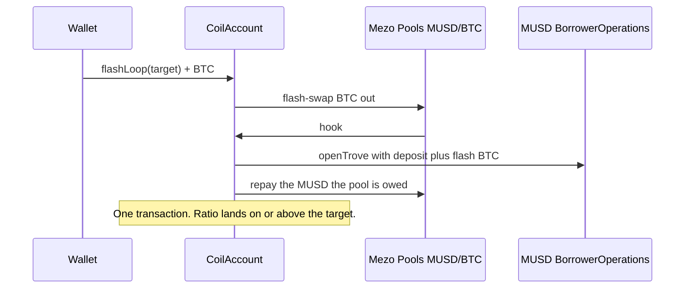

# Coil Labs

One transaction turns BTC into a leveraged BTC position on MUSD.

Deposit Bitcoin. Coil Labs flash-borrows BTC from the Mezo Pools MUSD/BTC pair, opens or tops up a trove, and repays the pool with the MUSD it just minted. About 4× (a 133.33% collateral ratio) fits in that single transaction. Unwind and de-lever are one transaction each. A keeper can only make a position safer, and earns MEZO when `guard()` actually raises the ratio.

Built by [Prabal Pratap Singh](https://prabal.pro) ([GitHub](https://github.com/PrabalParihar/coil), [X](https://x.com/0xPrabalParihar)). Source: [github.com/PrabalParihar/coil](https://github.com/PrabalParihar/coil).

**Live app:** [coil.up.railway.app](https://coil.up.railway.app) (Mezo testnet, chain 31611). The product name is Coil Labs. A different Wave 1 project also used the name Coil.

Clones are EIP-1167 and are not upgradeable. The live app and keeper use the Wave 2 factory `0x6A38f560cF8612cc81cF966831890DBb310e31F7`. This branch changes `CoilAccount` again (rescue slippage, an MUSD reserve, and a peg check), so that factory does not pick the change up. A new implementation and factory are required. `NEXT_PUBLIC_COIL_FACTORY` selects the factory. The code default is the current live factory. Nothing in this branch is deployed to Mezo mainnet.

## Problem

Looping BTC against MUSD by hand is a sequence of transactions that have to be sized against a moving oracle, a pool, a 110% liquidation line, and a 1,800 MUSD minimum debt. `openTrove` freezes borrowing capacity at the collateral you post in that call. Adding the BTC you just bought does not raise the cap. Only `refinance()` does. Hints have to be real, or `SortedTroves` walks the list and blows the block gas limit. A tight loop also sits at the front of the redemption queue.

Coil does that sizing inside one clone, in one loop transaction, and keeps a keeper that can only raise the ratio.

## How it works



`unwind` flash-borrows the MUSD needed to close or repay, then sends the BTC the pool is owed. `deleverTo` does the same for a partial repay that raises the ratio. If the pool factory is paused, both fall back to the Wave 1 one-sale path. `loop` is unchanged and still stops after two swaps.

Collateral ratios use Liquity's scale: `1e18` is 100%. Coil will not target below 115%. Liquidation is 110%. Leverage in the app is `CR / (CR − 1)`: 200% is 2.00×, 150% is 3.00×, 133.33% is 4.00×. Fork tests open at the 4× target in one `flashLoop`.

## How MUSD and Mezo Pools are used

MUSD is the debt. Every loop calls `BorrowerOperations.openTrove` or `withdrawMUSD` and mints MUSD to the clone. The protocol adds a borrowing fee (0.1% on testnet) and 200 MUSD of gas compensation. Net debt, excluding that 200, cannot fall below 1,800 MUSD except by closing.

Mezo Pools is the venue. The router is Tigris-style: `swapExactTokensForTokens(amountIn, amountOutMin, Route[], to, deadline)` with `Route { from, to, stable: false, factory }`. The testnet pool is the volatile MUSD/BTC pair. Coil sells the freshly minted MUSD for BTC, then `addColl` posts that BTC. A later round calls `refinance()` so the borrow cap includes the new collateral, then borrows again.

Repay does not approve MUSD. `BorrowerOperations.repayMUSD` burns it. `closeTrove` burns whatever is left, including the gas compensation, which `repayMUSD` is not allowed to clear on its own.

MEZO (`0x7B7c000000000000000000000000000000000001`, 18 decimals, same address on testnet and mainnet) pays the keeper. The owner approves the clone and calls `fundTips`. `guard()` transfers `min(tipMezo, balance)` to the caller only after the collateral ratio has risen, at most once per block. An empty jar still rescues. `withdrawTips` is owner-only. `transfer` and `balanceOf` on MEZO each count as a precompile call.

## Mezo contracts and precompiles

Every address below is the one this repository calls. Testnet and mainnet values live in `src/MezoAddresses.sol`. The app reads mainnet only to quote depth. It does not send a mainnet transaction.

| What | Role in Coil | Counts toward the 20-precompile cap |
| --- | --- | --- |
| BorrowerOperations | `openTrove`, `addColl`, `withdrawMUSD`, `repayMUSD`, `refinance`, `closeTrove`, `getCompositeDebt` | A price fetch inside `repayMUSD` is +2. The reserve path uses that. |
| TroveManager | ICR, debt, collateral, status, `checkRecoveryMode` | `fetchPrice` is not here. ICR reads are protocol calls. `checkRecoveryMode` is one call and is not a BTC precompile. |
| SortedTroves | Hints and the redemption walk (`getLast`, `getPrev`) | No. |
| HintHelpers | `getApproxHint` for inserts | No. |
| PriceFeed | `fetchPrice` | Yes. One fetch is 2 precompile calls. |
| Mezo Pools pool | `getReserves`, `token0`, `swap` (flash) | The MUSD→BTC swap is 3 BTC precompile calls. BTC→MUSD inside a flash repay is 4. |
| Pool factory | `getFee`, pause flag | No. |
| Router | Wave 1 exact-in swaps | The router's swap is the same BTC precompile family as the pool. |
| BTC precompile `0x7b7c…0000` | Collateral. `balanceOf` and `transfer` | Yes, each. |
| MEZO precompile `0x7b7c…0001` | Keeper tip. `balanceOf` and `transfer` | Yes, each. The tip path is +2. |
| MUSD | Debt token. Normal ERC-20, not a precompile | No. |
| Savings vault (optional) | `CoilPark.setVault` when an ERC-4626 asset is MUSD | No. No sMUSD address is set. See below. |

Documented budgets, from `precompileBudget()`: flash loop 7, unwind 8, de-lever 10, guard plus tip 12. A reserve repay adds one price fetch (+2). A second top-up from the park adds another. Worst case on a rescue that spends the reserve and then flashes is 16, under 20. MUSD `transfer` does not count.

`CoilPark` holds the reserve outside the clone so `sweep` cannot take it. The owner deposits MUSD. `guard` draws that MUSD and calls `repayMUSD` before any BTC is sold. There is no published sMUSD address on testnet or mainnet in the Mezo docs this repo checked, so the park holds plain MUSD. The implementation's deployer (`park.governor`) can later call `setVault` with an ERC-4626 whose `asset()` is MUSD. One park is shared by every clone of that implementation.

`foundry.toml` sets `bytecode_hash = "none"` so `CoilAccount` stays under EIP-170 after the reserve and peg checks. `forge verify` reads that setting. A verifier that assumes the default IPFS hash will not match.

## Live testnet (Wave 2 factory)

Chain 31611, RPC `https://rpc.test.mezo.org`, explorer `https://explorer.test.mezo.org`. Deployed 27 October 2026 in blocks 16400159–16400160. The app at [coil.up.railway.app](https://coil.up.railway.app) and the Railway keeper use this factory. Blockscout has not verified the contracts. The creation bytecode of that deployed build matched the chain. This branch's `CoilAccount` is a newer implementation and does not match those addresses.

| | Address |
| --- | --- |
| Factory (frontend and keeper) | [`0x6A38f560cF8612cc81cF966831890DBb310e31F7`](https://explorer.test.mezo.org/address/0x6A38f560cF8612cc81cF966831890DBb310e31F7) |
| CoilAccount implementation | [`0x522DED4F0cF62cfc12456A28FbF82b044178564b`](https://explorer.test.mezo.org/address/0x522DED4F0cF62cfc12456A28FbF82b044178564b) (23,101 bytes) |
| CoilLegacy | [`0xdb2e13c3199C28E69f6EaF39fb6df05900Dd7969`](https://explorer.test.mezo.org/address/0xdb2e13c3199C28E69f6EaF39fb6df05900Dd7969) |
| FlashSizer | [`0x3d1006Ec18E64238aFD2a176b438F40FBfa6F326`](https://explorer.test.mezo.org/address/0x3d1006Ec18E64238aFD2a176b438F40FBfa6F326) |
| Deployer | `0xf74E746a8d7A46A8b0f745C6d5944Ee672c1a3AF` |
| Keeper | `0x1D2621480011C44693a47801C1158E70b25b4B4F` |
| MUSD | `0x118917a40FAF1CD7a13dB0Ef56C86De7973Ac503` |
| MUSD/BTC pool | `0xd16A5Df82120ED8D626a1a15232bFcE2366d6AA9` |

| What | Transaction |
| --- | --- |
| CoilLegacy | [`0x6baa682e…`](https://explorer.test.mezo.org/tx/0x6baa682e4972ad287a493c4b87d40127b45efda7f26476cdbae42ab03a9bc4d6) |
| CoilAccount implementation | [`0x5e32f0d0…`](https://explorer.test.mezo.org/tx/0x5e32f0d0a591f768907fc3bc9e5d3e6623f522e0871f5616f0aaf3e1dba3ec5d) |
| CoilFactory | [`0xaaaae8e3…`](https://explorer.test.mezo.org/tx/0xaaaae8e3f0f8390f7595f7b2629159fa50893a219e652ba7e301367d76272f6b) |
| `flashLoop` 0.015 BTC to 133.33% (4×) | [`0x576e5383…`](https://explorer.test.mezo.org/tx/0x576e5383d45538f63658ffdc110d256a4d1a41779efbd7df9c4e0b3d55af0eef) |
| Keeper `guard()`, 133.30% → 150.00%, 1 MEZO | [`0xcb90da85…`](https://explorer.test.mezo.org/tx/0xcb90da8575306d82209d7ba49c0d21caef14e5d5527ec5b9486c4689d71fb54a) |
| `flashUnwind`, trove closed | [`0x296bb52c…`](https://explorer.test.mezo.org/tx/0x296bb52c8458bbdd0f00bd8c58f425655cccabb6409c3068bb87e36a9209c3d2) |

FlashSizer was created in the implementation constructor, so it has no separate deploy hash. That rescue needed `setSlippage(200)` first ([`0xf0db4179…`](https://explorer.test.mezo.org/tx/0xf0db4179b8d6101e3fe7df63bf2ea2dfa55ef6147fafa06c0854468380ad25fb)) because `guard()` reused the 0.5% open slippage while the pool sat about 1.4% under the oracle. This branch splits that cap. It is not on the factory above until a new deploy.

### Wave 1 factory

Still on chain. It has no `flashLoop` and no MEZO tip. The app no longer defaults to it.

| | Address |
| --- | --- |
| Factory | [`0xE29fAf17ed44B43c94D2Ff0e43E289aE49D98a3e`](https://explorer.test.mezo.org/address/0xE29fAf17ed44B43c94D2Ff0e43E289aE49D98a3e) |
| CoilAccount implementation | [`0x1bc9Ba4c62D62296aba1441fBB16BC9651a460Ce`](https://explorer.test.mezo.org/address/0x1bc9Ba4c62D62296aba1441fBB16BC9651a460Ce) (21,060 bytes) |
| Demo clone | [`0xC8ad8f93174C27c39FCC8463be05451C5E637650`](https://explorer.test.mezo.org/address/0xC8ad8f93174C27c39FCC8463be05451C5E637650) |

Throwaway deployer, testnet only: `0xFc58045fFB104D983de0e78F748Ab8e9cb6Bfc61`. The key is not in the repository.

| What | Transaction |
| --- | --- |
| Implementation | [`0x78994cd9…`](https://explorer.test.mezo.org/tx/0x78994cd91e7c10ef00a7172af8c3917846447f65c37dfbc3162bc5728f8d0fb7) |
| Factory | [`0x87d50bc5…`](https://explorer.test.mezo.org/tx/0x87d50bc5cbb6e02fcecbbeb92bad583fd7057cfd7ae8c53dfc6f2c6b70851186) |
| Loop 0.0475 BTC to 200.09% | [`0xfb9af425…`](https://explorer.test.mezo.org/tx/0xfb9af4255b2317ea89feb36c530c29bfeace97b0098a3c6074fec015f52d7f85) |
| De-lever toward 300%, landed at 288.04% (debt at the 1,800 floor) | [`0x8e742936…`](https://explorer.test.mezo.org/tx/0x8e742936951d59555c236f9c03dfd20d7d3d28d3a91b74e29f7863c18a6885a8) |
| Second de-lever, same target, succeeded and did not sell | [`0xbafe5283…`](https://explorer.test.mezo.org/tx/0xbafe5283fbcb373b167591cec8015b80606e5b970742bb17aa76ea70f47ff060) |
| Fresh 200% loop, 0.046 BTC | [`0xd72758f1…`](https://explorer.test.mezo.org/tx/0xd72758f1114ac3add69ed08a519603d1059c41c2fa959b9e225fc88769d9fd89) |
| Full unwind, sale 1 of 2 (debt to 2,000 MUSD, still open) | [`0x3ff34e57…`](https://explorer.test.mezo.org/tx/0x3ff34e57f63d0278bf5932442f786bd346e08028f40bae0cbb5dc1f5d2efc2fd) |
| Full unwind, sale 2 of 2 (trove closed) | [`0xd55cdf5f…`](https://explorer.test.mezo.org/tx/0xd55cdf5fb1d882f36f7c6cc66ff62960eeab30b8a4122240aa09329bcc8defdc) |

Every hash, the earlier factories, and the block numbers are in [DEPLOYMENTS.md](DEPLOYMENTS.md). The demo recording and screenshots are in [docs/media](docs/media): [coil-demo.mp4](docs/media/coil-demo.mp4) (2:52, 1440×900) and `01-hero.png` through `06-unwind.png`.

A 200% trove can be de-levered to 300% only when its debt is about 4,000 MUSD or more, because the protocol will not leave less than 1,800 MUSD of net debt unless the trove closes. That needs about 0.050 BTC deposited at the oracle used here (about $82,250). This wallet's 0.0475 BTC loop minted 3,860 MUSD, so one sale repaid down to the floor and the ratio stopped at 288%. The next call returned without reverting. Closing that trove, instead of pushing the ratio, is `unwind`.

## Architecture

```
wallet
  │  createAccount()
  ▼
CoilFactory ── EIP-1167 clone ── CoilAccount   ← this address owns the trove
                                    │
                                    ├─ BorrowerOperations.openTrove / addColl / refinance / withdrawMUSD / repayMUSD / closeTrove
                                    ├─ TroveManager, SortedTroves, HintHelpers, PriceFeed
                                    └─ Mezo Pools router, volatile MUSD ↔ BTC
```

`msg.sender` has to be the trove owner, and a trove cannot add and withdraw collateral in the same adjustment. The clone is the borrower, so borrow, swap, and add-collateral share one transaction. Mezo addresses are immutables on the implementation. The clone stores the owner, an optional keeper, slippage, and the guard.

| Call | Who | What it does |
| --- | --- | --- |
| `createAccount()` | wallet | Deploys that wallet's clone. One account per owner. |
| `flashLoop(targetCR, maxSlippageBps)` + BTC | owner | One flash swap. About 4× (CR 4/3) in one transaction. Reverts `Slippage` if the pool quote is outside the cap. |
| `loop(targetCR, maxSlippageBps)` + BTC | owner | Two borrow-and-swap rounds, then stops. Fallback when the pool is paused. |
| `setRescueSlippage(bps)` | owner | Slippage for `guard`, `flashUnwind`, and `flashDeleverTo`. Default 200 bps, hard cap 300. A keeper cannot set it. |
| `unwind` / `flashUnwind(fractionWad)` | owner | One flash repayment. `1e18` closes the trove and returns BTC. |
| `deleverTo` / `flashDeleverTo(targetCR)` | owner, or keeper up to the guard target | One flash repayment that raises the ratio. Returns when the 1,800 MUSD floor blocks a further raise. |
| `guard()` | anyone | De-levers to the guard target when the floor or the redemption zone says so. Pays MEZO only if the ratio rose. Cannot loop, unwind, or withdraw. |
| `setGuard(floor, target, zone)` | owner | Keeps the current tip. `zone` is how many places from the lowest-CR end count as redemption risk (max 32). |
| `setGuard(floor, target, zone, tip)` | owner | Same, and sets the MEZO tip. |
| `fundTips` / `withdrawTips` | owner | Pull MEZO in (needs `approve`) or send unused MEZO back. |

`openTrove` sets `maxBorrowingCapacity` from the collateral in that call. Coil adds the swapped BTC, refinances, then borrows again. The first open is capped at `collateral * price / 1.105e18`. Each step binary-searches a borrow whose projected ratio, after slippage and the refinance fee, stays at or above the target. The second round is not refinanced, because the transaction is about to stop. Ending safer than the target is allowed. Ending under it reverts `BelowTarget`.

Hints come from `HintHelpers.getApproxHint` (12 trials) and `SortedTroves.findInsertPosition`. They are ordinary contract calls, not precompile calls.

The keeper in `keeper/` is a dry-run by default. `--watch` (or `KEEPER_WATCH=true`) polls until stopped. It simulates `guard()` and, with `--execute`, sends that call with an explicit gas limit. It does not call `loop`, `unwind`, or `withdrawTips`. Swept BTC and MUSD go to the owner. Telegram alerts are optional: leave `TELEGRAM_BOT_TOKEN` and `TELEGRAM_CHAT_ID` unset and the process still runs. `/watch 0xClone` from that chat adds an address. `keeper/Dockerfile` and `keeper/railway.json` are the Railway shape. This repository does not create the Railway service.

The app is Next.js. Wallet connect uses the OrangeKit connectors that [Mezo Passport](https://github.com/mezo-org/passport) ships: Unisat, OKX, and Xverse for Bitcoin, plus injected EVM wallets and WalletConnect. Passport `0.17.2` itself does not compile here. Its entry imports `mezoTestnet` from `@mezo-org/orangekit`, and that package's entry does not re-export the chain, and the published `dist` imports a `./wallet` module that is not in the tarball. `npm run build` in `web/` writes a static export to `web/out`. `/guard` lists `Guarded`, `Delevered`, and `Heartbeat` logs. On Vercel, set the project root to `web`. Set `NEXT_PUBLIC_WALLETCONNECT_PROJECT_ID` for the WalletConnect option. The id is public.

## Security notes and risks

The clone is the only borrower. `loop`, `flashLoop`, `unwind`, `sweep`, `setGuard`, `fundTips`, and `withdrawTips` are `onlyOwner`. `deleverTo` above the guard target is owner-only. `guard()` is permissionless and only runs when the owner has set a guard. It never transfers BTC or MUSD to the caller. `nonReentrant` covers the state-changing flows. Slippage is capped at 3%. The implementation is pinned in the factory. Clones are not upgradeable. The factory owner can change the factory keeper and transfer ownership. That keeper still cannot withdraw.

- **Liquidation.** A trove can be liquidated at 110%. Coil will not target below 115%, and the guard is off until the owner sets one.
- **Redemption.** Redemptions hit the lowest nominal collateral ratio first. A tight coil sits at the front of that queue. The guard walks at most 32 troves from the tail.
- **Minimum debt.** Net debt cannot drop below 1,800 MUSD except by closing. A de-lever that has already hit that floor cannot raise the ratio further. Coil returns instead of selling collateral it cannot repay. Partial unwind stops at the same floor.
- **Oracle versus pool.** The collateral ratio uses `PriceFeed`. The swap uses pool reserves. The preview uses both, with slippage taken off the quoted output.
- **Fees.** Testnet borrowing rate is 0.1%. Refinance charges that rate on 20% of net debt, about 0.02%. The testnet pool fee is 4 bps. Interest (1% APR on testnet) accrues outside the loop transaction.
- **Recovery Mode.** Opens are refused while the system is in Recovery Mode. Closing can revert there too.
- **Mainnet pool.** The mainnet MUSD/BTC pool is a different address, BTC is `token0`, the fee is 30 bps, and the book is thin (well under 1 BTC on 19 October 2026). This repository does not deploy there. A mainnet beta needs a size cap.
- **No audit.** These contracts have fork tests and a public testnet deploy. They have not been audited. Do not point them at mainnet funds.

## The 20-precompile-call budget

A Mezo transaction may call native precompiles 20 times. Call 21 reverts with empty data. Measured on a budget probe: `balanceOf` succeeds 20 times and the 21st reverts. `EXTCODEHASH` does not count. `getAmountsOut` and hint calls do not count. `PriceFeed.fetchPrice` is two calls (`latestRoundData` and `decimals`). In the testnet MUSD/BTC pool, a MUSD→BTC swap is three BTC calls: the output transfer and two `balanceOf` reads. A BTC→MUSD swap is about five if the clone also reads its own balance. Each BorrowerOperations call fetches the price again.

`loop` still stops after two swaps. A third MUSD→BTC swap is the 21st precompile call, and the pool surfaces it as `SafeERC20: low-level call failed`.

`flashLoop` does not take that path. A new-trove flash is `fetchPrice` (2) plus `openTrove`'s own `fetchPrice` (2) plus a BTC-out swap (3) = 7. Flash close is 8. Flash de-lever is 10. `guard()` adds a MEZO `balanceOf` and `transfer` = 12. All of those sit under 20, with margin. The pool's volatile check is `(reserveIn + amountInAfterFee) * (reserveOut - amountOut) >= k`, not a Uniswap V2 fee-adjusted `k`. `FlashSizer.amountIn` walks a few wei until that holds. Shanghai has no transient storage, so the in-flash flag is storage and the callback clears it.

`cast estimate` on this RPC is not a signal. Broadcasts go out only after `eth_call` succeeds, with an explicit gas limit under the 10,000,000 block cap.

## Setup, tests, deploy

[Foundry](https://book.getfoundry.sh/getting-started/installation) and Node 22. This repo was built with Foundry 1.8.5, solc 0.8.24, Shanghai, optimizer 200, `via_ir`.

```bash
forge build
forge test
```

`forge test` forks `https://rpc.test.mezo.org`. Mezo blocks omit Cancun blob fields, so `foundry.toml` pins `evm_version = "shanghai"`.

```bash
anvil --fork-url https://rpc.test.mezo.org --hardfork shanghai --port 18545
```

`test/Coil.t.sol` covers the Wave 1 loop plus flash loop at 3× and about 4×, one-call unwind and de-lever, MEZO tips, and a keeper who cannot take funds. `test/FlashMath.t.sol` fuzzes the constant-product input. `test/KeeperInvariant.t.sol` checks that keeper and stranger calls do not lower the ratio or move BTC or MUSD. See [SECURITY.md](SECURITY.md).

### Deploy

Copy `.env.example`. Put a testnet key in `PRIVATE_KEY`. Do not commit it. Mezo testnet enforces EIP-170 (24,576 bytes). `CoilAccount` calls `CoilLegacy` by delegatecall so the implementation fits. Foundry deploys and links that library inside the one broadcast below. `cast send --create` of `forge inspect` bytecode does not link it, so use `forge script`.

```bash
# local fork, not a Mezo broadcast
anvil --fork-url https://rpc.test.mezo.org --hardfork shanghai --port 18545
PRIVATE_KEY=0xac0974bec39a17e36ba4a6b4d238ff944bacb478cbed5efcae784d7bf4f2ff80 \
  forge script script/Deploy.s.sol --rpc-url http://127.0.0.1:18545 --broadcast
```

The script needs only `PRIVATE_KEY`. It deploys `CoilAccount` with the testnet addresses in `src/MezoAddresses.sol`, including the MUSD/BTC pool, then `CoilFactory(implementation, deployer)`. Foundry deploys `CoilLegacy` in that same broadcast and links it. `CoilAccount`'s constructor deploys `FlashSizer` (nonce 1) and `CoilPark` (nonce 2). The log lines are `legacy`, `sizer`, `park`, `implementation`, and `factory`. `verify.sh` does not take the park address. Verify the park on its own if you want it on Blockscout.

`forge create` against `https://rpc.test.mezo.org` has been seen talking to `http://localhost:8545`. `forge script` is the path that takes `--rpc-url`. Fund the deployer from [faucet.test.mezo.org](https://faucet.test.mezo.org) (the faucet can require a captcha). Then:

```bash
# copy .env.example to .env and set PRIVATE_KEY. Do not commit .env.
set -a && source .env && set +a
forge script script/Deploy.s.sol --rpc-url "$MEZO_TESTNET_RPC" --broadcast
LEGACY=0x… SIZER=0x… IMPL=0x… FACTORY=0x… OWNER=0xYourDeployer ./script/verify.sh
```

`script/verify.sh` submits `CoilLegacy`, `FlashSizer`, the implementation (with `--libraries`), and the factory to Blockscout at `https://api.explorer.test.mezo.org/api`. After the factory exists, set `NEXT_PUBLIC_COIL_FACTORY` and `COIL_FACTORY` to it and redeploy the web app and the keeper. The Wave 1 clones stay on the old factory. They are not upgraded. `forge build --sizes` fails the build when a runtime exceeds 24,576 bytes, and CI dry-runs the script on a local fork.

### Keeper

```bash
cd keeper
npm install
# dry run against the live Wave 2 factory, no key, no Telegram
COIL_FACTORY=0x6A38f560cF8612cc81cF966831890DBb310e31F7 npm start
# poll until you stop it
COIL_FACTORY=0x6A38f560cF8612cc81cF966831890DBb310e31F7 npm start -- --watch
# send guard()
COIL_FACTORY=0x… KEEPER_PRIVATE_KEY=0x… npm start -- --execute
```

Railway: the keeper service is already running against the live Wave 2 factory. From `keeper/`, the Dockerfile and `railway.json` are the service shape. Set `COIL_FACTORY`, `MEZO_TESTNET_RPC`, `KEEPER_PRIVATE_KEY`, `COIL_EXECUTE=true`, and `KEEPER_WATCH=true`. Do not put the key in the repo. A failed `guard()` simulation logs the decoded revert, for example `Slippage()`. The Wave 1 “owner/keeper only” line is printed only when the revert is `NotKeeper()`. Rebuilding the Railway service is what picks that logging up. On the Wave 1 factory, `guard()` is still the owner or the factory keeper.

Telegram is optional and off when either variable is empty. Set both on Railway later. Do not commit the token.

| Variable | Meaning |
| --- | --- |
| `TELEGRAM_BOT_TOKEN` | Bot token from BotFather. It is sent only to `api.telegram.org` and is never printed. A failed send logs the HTTP status and a short body. |
| `TELEGRAM_CHAT_ID` | The chat that receives alerts and is allowed to send `/watch`, `/unwatch`, and `/help`. |

Alerts fire when a trove is under its floor, inside its redemption zone, or near the queue while MUSD is under $1 by at least `pegGuardBps` (0 disables that trigger). A successful `guard()` and a reverted one each send a message with the explorer link. `npm run check` in `keeper/` covers the revert decoder and these rules without a token.

### Frontend

```bash
cd web
npm install
npm run dev          # http://127.0.0.1:43123
npm run build        # static export in web/out
```

The page defaults to factory `0x6A38f560cF8612cc81cF966831890DBb310e31F7`. Override with `NEXT_PUBLIC_COIL_FACTORY`. Open slippage defaults to 1%. Rescue and close use a separate 2% cap when the account exposes `rescueSlippageBps`; the live factory does not, so the same control calls `setSlippage` there (still capped at 3%). `/guard` and `/stats` read logs from block 16400159 in chunks of 9,999 blocks and show an RPC error instead of an empty page. The live site gets that paging when the web service is rebuilt.

Wallet connect uses the Unisat, OKX, and Xverse connectors from `@mezo-org/orangekit`, which is what Mezo Passport 0.17.2 ships, plus an injected wallet and WalletConnect. Passport itself does not compile: `dist/src/constants.js` imports `mezoTestnet` from `@mezo-org/orangekit`, and orangekit 1.0.0-beta.40 (the version Passport depends on) does not re-export it. The desk still offers those Bitcoin wallets next to EVM wallets.

The desk quotes max sensible leverage from the live testnet pool and, read-only, from the mainnet MUSD/BTC pool. The cap is 1% price impact. Mainnet is not a deploy target. The reserve panel appears when the factory's implementation exposes `park()`. The live factory does not, so the panel explains that a rescue still sells BTC.

```bash
cd keeper && npx tsc --noEmit
```

## Wave 2

Deployed on Mezo testnet and exercised end to end. See the table above and [DEPLOYMENTS.md](DEPLOYMENTS.md).

- `flashLoop`, `flashUnwind`, and `flashDeleverTo`: one transaction each. Fork test reaches about 4.00× (target CR `4e18/3`). The live run opened 0.015 BTC at 133.33%.
- Permissionless `guard()` with a MEZO tip only when the ratio rises. The live keeper raised 133.30% to 150.00% and was paid 1 MEZO.
- Keeper on Railway, optional Telegram, and a public `/guard` log.
- OrangeKit wallet connect, a redemption-rank preview, `script/verify.sh`, and the Coil Labs name.

This branch, not yet deployed:

- `rescueSlippageBps`, owner-set, default 2%, hard cap 3%. `guard` and flash close use it. Open keeps `slippageBps`.
- MUSD reserve in `CoilPark`. `guard` repays from it before selling BTC. Optional ERC-4626 adapter, no sMUSD address configured.
- Peg gate on `flashLoop` (default 200 bps, hard cap 500) and an opt-in peg trigger on `guard`. Recovery Mode still reverts a new loop.
- Depth quote: `FlashSizer.sensibleTarget`, capped at 100 bps of impact. The UI shows the same idea for testnet and for mainnet, read-only.
- `/stats` and the Telegram rules above. Those ship when the web app and the keeper process are rebuilt. They do not need a new factory. The reserve, the peg gate, and the rescue-slippage split do.

A new `CoilAccount`, linked `CoilLegacy`, `FlashSizer`, `CoilPark`, and factory are required before any of the contract changes are live. `script/Deploy.s.sol` is still one broadcast and now also logs the park.

Not done: Blockscout verification, a second end-to-end run on the new factory, a recut video, an AKINDO comment, a mainnet deploy, and a live sMUSD address. Gauge code is intentionally absent. The design is in [docs/GAUGE.md](docs/GAUGE.md). See [CHANGELOG.md](CHANGELOG.md) and [THREAT_MODEL.md](THREAT_MODEL.md).

Invariants and the test names are in [SECURITY.md](SECURITY.md). The Wave 2 update text, for the submission form, is in [docs/SUBMISSION.md](docs/SUBMISSION.md).

## License

[MIT](LICENSE). Copyright 2026 Prabal Pratap Singh.
