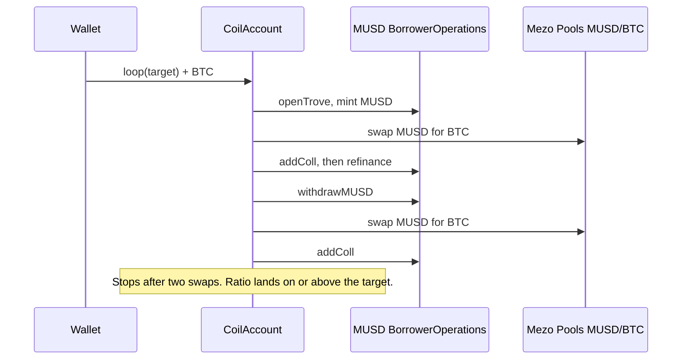

# Coil

One transaction turns BTC into a leveraged BTC position on MUSD.

Deposit Bitcoin. Coil opens a Mezo trove, swaps the borrowed MUSD for more BTC on Mezo Pools, and posts that BTC back as collateral until the collateral ratio you pick. De-lever and unwind sell collateral the other way, one sale per transaction, until the position is safer or closed. A keeper can only make a position safer.

Built by [Prabal Pratap Singh](https://prabal.pro) ([GitHub](https://github.com/PrabalParihar), [X](https://x.com/0xPrabalParihar)) for Mezo Buildathon Wave 1.

## Problem

Looping BTC against MUSD by hand is a sequence of transactions that have to be sized against a moving oracle, a pool, a 110% liquidation line, and a 1,800 MUSD minimum debt. `openTrove` freezes borrowing capacity at the collateral you post in that call. Adding the BTC you just bought does not raise the cap. Only `refinance()` does. Hints have to be real, or `SortedTroves` walks the list and blows the block gas limit. A tight loop also sits at the front of the redemption queue.

Coil does that sizing inside one clone, in one loop transaction, and keeps a keeper that can only raise the ratio.

## How it works



The same clone runs the reverse path. `deleverTo` withdraws collateral, swaps BTC for MUSD, and repays. `unwind(100%)` does that until it can `closeTrove` and send the BTC home. On live Mezo each of those calls sells collateral once. If the ratio is still short, or the trove is not closed yet, the call succeeds and the app sends the next one. The screen shows each transaction and links it on the explorer.

Collateral ratios use Liquity's scale: `1e18` is 100%. Coil will not target below 115%. Liquidation is 110%. Leverage in the app is `CR / (CR − 1)`: 200% is 2.00×, 150% is 3.00×.

## How MUSD and Mezo Pools are used

MUSD is the debt. Every loop calls `BorrowerOperations.openTrove` or `withdrawMUSD` and mints MUSD to the clone. The protocol adds a borrowing fee (0.1% on testnet) and 200 MUSD of gas compensation. Net debt, excluding that 200, cannot fall below 1,800 MUSD except by closing.

Mezo Pools is the venue. The router is Tigris-style: `swapExactTokensForTokens(amountIn, amountOutMin, Route[], to, deadline)` with `Route { from, to, stable: false, factory }`. The testnet pool is the volatile MUSD/BTC pair. Coil sells the freshly minted MUSD for BTC, then `addColl` posts that BTC. A later round calls `refinance()` so the borrow cap includes the new collateral, then borrows again.

Repay does not approve MUSD. `BorrowerOperations.repayMUSD` burns it. `closeTrove` burns whatever is left, including the gas compensation, which `repayMUSD` is not allowed to clear on its own.

The MEZO token is not in this wave. Nothing in the loop, the keeper, or the app transfers MEZO. Wave 2 is where a keeper tip and a gauge reward would be denominated in MEZO.

## Live testnet

Chain 31611, RPC `https://rpc.test.mezo.org`, explorer `https://explorer.test.mezo.org`.

| | Address |
| --- | --- |
| Factory (frontend and keeper) | [`0xE29fAf17ed44B43c94D2Ff0e43E289aE49D98a3e`](https://explorer.test.mezo.org/address/0xE29fAf17ed44B43c94D2Ff0e43E289aE49D98a3e) |
| CoilAccount implementation | [`0x1bc9Ba4c62D62296aba1441fBB16BC9651a460Ce`](https://explorer.test.mezo.org/address/0x1bc9Ba4c62D62296aba1441fBB16BC9651a460Ce) |
| Demo clone | [`0xC8ad8f93174C27c39FCC8463be05451C5E637650`](https://explorer.test.mezo.org/address/0xC8ad8f93174C27c39FCC8463be05451C5E637650) |
| MUSD | `0x118917a40FAF1CD7a13dB0Ef56C86De7973Ac503` |
| MUSD/BTC pool | `0xd16A5Df82120ED8D626a1a15232bFcE2366d6AA9` |

Throwaway deployer, testnet only: `0xFc58045fFB104D983de0e78F748Ab8e9cb6Bfc61`. The key is not in the repository.

| What | Transaction |
| --- | --- |
| Implementation | [`0x78994cd9…`](https://explorer.test.mezo.org/tx/0x78994cd91e7c10ef00a7172af8c3917846447f65c37dfbc3162bc5728f8d0fb7) |
| Factory | [`0x87d50bc5…`](https://explorer.test.mezo.org/tx/0x87d50bc5cbb6e02fcecbbeb92bad583fd7057cfd7ae8c53dfc6f2c6b70851186) |
| Loop 0.0475 BTC to 200.09% | [`0xfb9af425…`](https://explorer.test.mezo.org/tx/0xfb9af4255b2317ea89feb36c530c29bfeace97b0098a3c6074fec015f52d7f85) |
| De-lever toward 300%, landed at 288.04% (debt at the 1,800 floor) | [`0x8e742936…`](https://explorer.test.mezo.org/tx/0x8e742936951d59555c236f9c03dfd20d7d3d28d3a91b74e29f7863c18a6885a8) |
| Second de-lever, same target, succeeded and did not sell | [`0xbafe5283…`](https://explorer.test.mezo.org/tx/0xbafe5283fbcb373b167591cec8015b80606e5b970742bb17aa76ea70f47ff060) |
| Fresh 200% loop, 0.046 BTC | [`0xd72758f1…`](https://explorer.test.mezo.org/tx/0xd72758f1114ac3add69ed08a519603d1059c41c2fa959b9e225fc88769d9fd89) |
| Full unwind, sale 1 of 2 (debt to 2,000 MUSD, still open) | [`0x3ff34e57…`](https://explorer.test.mezo.org/tx/0x3ff34e57f63d0278bf5932442f786bd346e08028f40bae0cbb5dc1f5d2efc2fd) |
| Full unwind, sale 2 of 2 (trove closed) | [`0xd55cdf5f…`](https://explorer.test.mezo.org/tx/0xd55cdf5fb1d882f36f7c6cc66ff62960eeab30b8a4122240aa09329bcc8defdc) |

Every hash, the earlier factories, and the block numbers are in [DEPLOYMENTS.md](DEPLOYMENTS.md). The demo recording and screenshots are in [docs/media](docs/media): [coil-demo.mp4](docs/media/coil-demo.mp4) (2:52, 1440×900) and `01-hero.png` through `06-unwind.png`.

A 200% trove can be de-levered to 300% only when its debt is about 4,000 MUSD or more, because the protocol will not leave less than 1,800 MUSD of net debt unless the trove closes. That needs about 0.050 BTC deposited at the oracle used here (about $82,250). This wallet's 0.0475 BTC loop minted 3,860 MUSD, so one sale repaid down to the floor and the ratio stopped at 288%. The next call returned without reverting. Closing that trove, instead of pushing the ratio, is `unwind`.

## Architecture

```
wallet
  │  createAccount()
  ▼
CoilFactory ── EIP-1167 clone ── CoilAccount   ← this address owns the trove
                                    │
                                    ├─ BorrowerOperations.openTrove / addColl / refinance / withdrawMUSD / repayMUSD / closeTrove
                                    ├─ TroveManager, SortedTroves, HintHelpers, PriceFeed
                                    └─ Mezo Pools router, volatile MUSD ↔ BTC
```

`msg.sender` has to be the trove owner, and a trove cannot add and withdraw collateral in the same adjustment. The clone is the borrower, so borrow, swap, and add-collateral share one transaction. Mezo addresses are immutables on the implementation. The clone stores the owner, an optional keeper, slippage, and the guard.

| Call | Who | What it does |
| --- | --- | --- |
| `createAccount()` | wallet | Deploys that wallet's clone. One account per owner. |
| `loop(targetCR, maxSlippageBps)` + BTC | owner | Opens or tops up. Two borrow-and-swap rounds, then stops. |
| `unwind(fractionWad)` | owner | Repays that fraction of net debt. `1e18` closes the trove. On Mezo, one collateral sale per call. |
| `deleverTo(targetCR)` | owner or keeper | Sells collateral, swaps to MUSD, repays. On Mezo, one sale per call. Returns, rather than reverts, when another sale cannot raise the ratio. |
| `guard()` | owner or keeper | If the ratio is under the floor, or the trove is inside the redemption zone, de-levers up to the guard target. |
| `setGuard(floor, target, zone)` | owner | `zone` is how many places from the lowest-CR end of `SortedTroves` count as redemption risk (max 32). All zeros disables the guard. |

`openTrove` sets `maxBorrowingCapacity` from the collateral in that call. Coil adds the swapped BTC, refinances, then borrows again. The first open is capped at `collateral * price / 1.105e18`. Each step binary-searches a borrow whose projected ratio, after slippage and the refinance fee, stays at or above the target. The second round is not refinanced, because the transaction is about to stop. Ending safer than the target is allowed. Ending under it reverts `BelowTarget`.

Hints come from `HintHelpers.getApproxHint` (12 trials) and `SortedTroves.findInsertPosition`. They are ordinary contract calls, not precompile calls.

The keeper in `keeper/` is a dry-run by default. With `--execute` it sends `deleverTo(guardTargetCR)` up to four times and stops when the ratio stops rising. A keeper cannot `loop`, `unwind`, or aim above the owner's guard target. Swept BTC and MUSD go to the owner.

The app is Next.js, wagmi, and viem. `npm run build` in `web/` writes a static export to `web/out`. On Vercel, set the project root to `web`.

## Security notes and risks

The clone is the only borrower. `loop`, `unwind`, `sweep`, and `setGuard` are `onlyOwner`. A keeper can call `deleverTo` only up to `guardTargetCR`, and `guard()` only when the owner has set a guard. Neither path transfers BTC or MUSD to the keeper. `nonReentrant` covers the state-changing flows. Slippage is capped at 3%. The implementation is pinned in the factory. Clones are not upgradeable. The factory owner can change the factory keeper and transfer ownership. That keeper still cannot withdraw.

- **Liquidation.** A trove can be liquidated at 110%. Coil will not target below 115%, and the guard is off until the owner sets one.
- **Redemption.** Redemptions hit the lowest nominal collateral ratio first. A tight coil sits at the front of that queue. The guard walks at most 32 troves from the tail.
- **Minimum debt.** Net debt cannot drop below 1,800 MUSD except by closing. A de-lever that has already hit that floor cannot raise the ratio further. Coil returns instead of selling collateral it cannot repay. Partial unwind stops at the same floor.
- **Oracle versus pool.** The collateral ratio uses `PriceFeed`. The swap uses pool reserves. The preview uses both, with slippage taken off the quoted output.
- **Fees.** Testnet borrowing rate is 0.1%. Refinance charges that rate on 20% of net debt, about 0.02%. The testnet pool fee is 4 bps. Interest (1% APR on testnet) accrues outside the loop transaction.
- **Recovery Mode.** Opens are refused while the system is in Recovery Mode. Closing can revert there too.
- **Mainnet pool.** The mainnet MUSD/BTC pool is a different address, BTC is `token0`, the fee is 30 bps, and the book is thin (well under 1 BTC on 19 October 2026). This repository does not deploy there. A mainnet beta needs a size cap.
- **No audit.** These contracts have fork tests and a public testnet deploy. They have not been audited. Do not point them at mainnet funds.

## The 20-precompile-call budget

A Mezo transaction may call native precompiles 20 times. Call 21 reverts with empty data. Measured on a budget probe: `balanceOf` succeeds 20 times and the 21st reverts. `EXTCODEHASH` does not count. `getAmountsOut` and hint calls do not count. `PriceFeed.fetchPrice` is two calls (`latestRoundData` and `decimals`). In the testnet MUSD/BTC pool, a MUSD→BTC swap is three BTC calls: the output transfer and two `balanceOf` reads. A BTC→MUSD swap is about five if the clone also reads its own balance. Each BorrowerOperations call fetches the price again.

Two borrow-and-swap rounds use 18 of the 20 calls and land on a 200% target. A third MUSD→BTC swap is the 21st precompile call. The pool surfaces it as `SafeERC20: low-level call failed` and the whole loop reverts. `loop` therefore stops after two swaps. `cast estimate` on this RPC is not a signal: it has returned a few hundred thousand gas for both a reverting loop and a succeeding one. Broadcasts go out only after `eth_call` succeeds, with an explicit gas limit under the 10,000,000 block cap. The app sets the same limits.

De-lever and unwind hit the same wall if they sell twice in one transaction. On the live BTC mirror (`EXTCODEHASH` `0x646ced85…`) each call sells once and returns. The next call continues. A sale that cannot raise the ratio, including a few wei of repay room above the 1,800 floor, is skipped. Fork tests etch a WETH-style mock at the BTC address, so the codehash differs and those tests still run several sales inside one call.

## Setup, tests, deploy

[Foundry](https://book.getfoundry.sh/getting-started/installation) and Node 22. This repo was built with Foundry 1.8.5, solc 0.8.24, Shanghai, optimizer 200, `via_ir`.

```bash
forge build
forge test
```

`forge test` forks `https://rpc.test.mezo.org`. Mezo blocks omit Cancun blob fields, so `foundry.toml` pins `evm_version = "shanghai"`.

```bash
anvil --fork-url https://rpc.test.mezo.org --hardfork shanghai --port 18545
```

`test/Coil.t.sol` reads live protocol parameters, opens a trove, loops 0.2 BTC to 200% and checks the quote, reverts a deposit that cannot clear minimum debt, closes and partially unwinds, rejects a keeper who tries to unwind or to de-lever past the guard, de-levers through `guard()` after a mocked price drop, tops up a trove, and gives two users two clones.

### Deploy

`forge create` against `https://rpc.test.mezo.org` tries `http://localhost:8545`. The live deploy used `forge inspect` bytecode and `cast send --create`. Copy `.env.example`. Put a testnet key in `PRIVATE_KEY`. Do not commit it.

```bash
# local fork
PRIVATE_KEY=0x… forge script script/Deploy.s.sol --rpc-url http://127.0.0.1:18545 --broadcast
```

The script deploys `CoilAccount` with the testnet addresses in `src/MezoAddresses.sol`, then `CoilFactory(implementation, deployer)`.

### Keeper

```bash
cd keeper
npm install
COIL_FACTORY=0xE29fAf17ed44B43c94D2Ff0e43E289aE49D98a3e npm start
COIL_FACTORY=0xE29fAf17ed44B43c94D2Ff0e43E289aE49D98a3e KEEPER_PRIVATE_KEY=0x… npm start -- --execute
```

### Frontend

```bash
cd web
npm install
npm run dev          # http://127.0.0.1:43123
npm run build        # static export in web/out
```

The page defaults to factory `0xE29fAf17ed44B43c94D2Ff0e43E289aE49D98a3e`. Override with `NEXT_PUBLIC_COIL_FACTORY`.

```bash
cd keeper && npx tsc --noEmit
```

## Wave 2

- An always-on keeper, watching the floor and the redemption zone without a manual `--execute`.
- Telegram alerts when a trove crosses the floor, enters the redemption zone, or a de-lever fails.
- A vault share token so a deposit can be a position in a shared coil instead of a personal clone.
- MEZO gauge rewards for pool volume, and keeper tips paid in MEZO when `guard()` does the work.
- A capped mainnet beta, with a maximum loop size set against the thin MUSD/BTC pool.

## License

[MIT](LICENSE). Copyright 2026 Prabal Pratap Singh.
