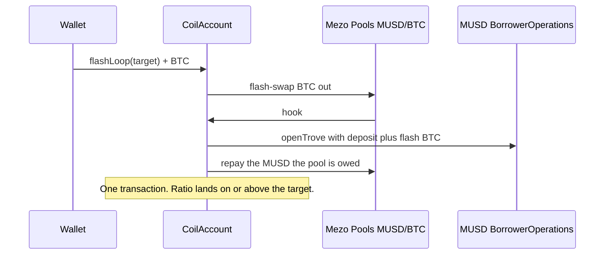

# Coil Labs

One transaction turns BTC into a leveraged BTC position on MUSD.

Deposit Bitcoin. Coil Labs flash-borrows BTC from the Mezo Pools MUSD/BTC pair, opens or tops up a trove, and repays the pool with the MUSD it just minted. About 4× (a 133.33% collateral ratio) fits in that single transaction. Unwind and de-lever are one transaction each. A keeper can only make a position safer, and earns MEZO when `guard()` actually raises the ratio.

Built by [Prabal Pratap Singh](https://prabal.pro) ([GitHub](https://github.com/PrabalParihar/coil), [X](https://x.com/0xPrabalParihar)). Source: [github.com/PrabalParihar/coil](https://github.com/PrabalParihar/coil).

**Live app:** [coil.up.railway.app](https://coil.up.railway.app) (Mezo testnet, chain 31611). The site still points at the Wave 1 factory until the Wave 2 factory in this branch is deployed. A different Wave 1 project also used the name Coil. This repository is Coil Labs.

Clones are EIP-1167 and are not upgradeable. Wave 2 is a new implementation and a new factory. `NEXT_PUBLIC_COIL_FACTORY` selects it. Until that address changes, the app keeps the Wave 1 two-swap `loop`.

## Problem

Looping BTC against MUSD by hand is a sequence of transactions that have to be sized against a moving oracle, a pool, a 110% liquidation line, and a 1,800 MUSD minimum debt. `openTrove` freezes borrowing capacity at the collateral you post in that call. Adding the BTC you just bought does not raise the cap. Only `refinance()` does. Hints have to be real, or `SortedTroves` walks the list and blows the block gas limit. A tight loop also sits at the front of the redemption queue.

Coil does that sizing inside one clone, in one loop transaction, and keeps a keeper that can only raise the ratio.

## How it works



`unwind` flash-borrows the MUSD needed to close or repay, then sends the BTC the pool is owed. `deleverTo` does the same for a partial repay that raises the ratio. If the pool factory is paused, both fall back to the Wave 1 one-sale path. `loop` is unchanged and still stops after two swaps.

Collateral ratios use Liquity's scale: `1e18` is 100%. Coil will not target below 115%. Liquidation is 110%. Leverage in the app is `CR / (CR − 1)`: 200% is 2.00×, 150% is 3.00×, 133.33% is 4.00×. Fork tests open at the 4× target in one `flashLoop`.

## How MUSD and Mezo Pools are used

MUSD is the debt. Every loop calls `BorrowerOperations.openTrove` or `withdrawMUSD` and mints MUSD to the clone. The protocol adds a borrowing fee (0.1% on testnet) and 200 MUSD of gas compensation. Net debt, excluding that 200, cannot fall below 1,800 MUSD except by closing.

Mezo Pools is the venue. The router is Tigris-style: `swapExactTokensForTokens(amountIn, amountOutMin, Route[], to, deadline)` with `Route { from, to, stable: false, factory }`. The testnet pool is the volatile MUSD/BTC pair. Coil sells the freshly minted MUSD for BTC, then `addColl` posts that BTC. A later round calls `refinance()` so the borrow cap includes the new collateral, then borrows again.

Repay does not approve MUSD. `BorrowerOperations.repayMUSD` burns it. `closeTrove` burns whatever is left, including the gas compensation, which `repayMUSD` is not allowed to clear on its own.

MEZO (`0x7B7c000000000000000000000000000000000001`, 18 decimals, same address on testnet and mainnet) pays the keeper. The owner approves the clone and calls `fundTips`. `guard()` transfers `min(tipMezo, balance)` to the caller only after the collateral ratio has risen, at most once per block. An empty jar still rescues. `withdrawTips` is owner-only. `transfer` and `balanceOf` on MEZO each count as a precompile call.

## Live testnet (Wave 1 factory)

The addresses below are the factory the app and keeper use until a Wave 2 deploy. They do not include `flashLoop` or MEZO tips. Deployment steps for the new factory are under [Deploy](#deploy). Nothing in this branch was broadcast.

Chain 31611, RPC `https://rpc.test.mezo.org`, explorer `https://explorer.test.mezo.org`.

| | Address |
| --- | --- |
| Factory (frontend and keeper) | [`0xE29fAf17ed44B43c94D2Ff0e43E289aE49D98a3e`](https://explorer.test.mezo.org/address/0xE29fAf17ed44B43c94D2Ff0e43E289aE49D98a3e) |
| CoilAccount implementation | [`0x1bc9Ba4c62D62296aba1441fBB16BC9651a460Ce`](https://explorer.test.mezo.org/address/0x1bc9Ba4c62D62296aba1441fBB16BC9651a460Ce) |
| Demo clone | [`0xC8ad8f93174C27c39FCC8463be05451C5E637650`](https://explorer.test.mezo.org/address/0xC8ad8f93174C27c39FCC8463be05451C5E637650) |
| MUSD | `0x118917a40FAF1CD7a13dB0Ef56C86De7973Ac503` |
| MUSD/BTC pool | `0xd16A5Df82120ED8D626a1a15232bFcE2366d6AA9` |

Throwaway deployer, testnet only: `0xFc58045fFB104D983de0e78F748Ab8e9cb6Bfc61`. The key is not in the repository.

| What | Transaction |
| --- | --- |
| Implementation | [`0x78994cd9…`](https://explorer.test.mezo.org/tx/0x78994cd91e7c10ef00a7172af8c3917846447f65c37dfbc3162bc5728f8d0fb7) |
| Factory | [`0x87d50bc5…`](https://explorer.test.mezo.org/tx/0x87d50bc5cbb6e02fcecbbeb92bad583fd7057cfd7ae8c53dfc6f2c6b70851186) |
| Loop 0.0475 BTC to 200.09% | [`0xfb9af425…`](https://explorer.test.mezo.org/tx/0xfb9af4255b2317ea89feb36c530c29bfeace97b0098a3c6074fec015f52d7f85) |
| De-lever toward 300%, landed at 288.04% (debt at the 1,800 floor) | [`0x8e742936…`](https://explorer.test.mezo.org/tx/0x8e742936951d59555c236f9c03dfd20d7d3d28d3a91b74e29f7863c18a6885a8) |
| Second de-lever, same target, succeeded and did not sell | [`0xbafe5283…`](https://explorer.test.mezo.org/tx/0xbafe5283fbcb373b167591cec8015b80606e5b970742bb17aa76ea70f47ff060) |
| Fresh 200% loop, 0.046 BTC | [`0xd72758f1…`](https://explorer.test.mezo.org/tx/0xd72758f1114ac3add69ed08a519603d1059c41c2fa959b9e225fc88769d9fd89) |
| Full unwind, sale 1 of 2 (debt to 2,000 MUSD, still open) | [`0x3ff34e57…`](https://explorer.test.mezo.org/tx/0x3ff34e57f63d0278bf5932442f786bd346e08028f40bae0cbb5dc1f5d2efc2fd) |
| Full unwind, sale 2 of 2 (trove closed) | [`0xd55cdf5f…`](https://explorer.test.mezo.org/tx/0xd55cdf5fb1d882f36f7c6cc66ff62960eeab30b8a4122240aa09329bcc8defdc) |

Every hash, the earlier factories, and the block numbers are in [DEPLOYMENTS.md](DEPLOYMENTS.md). The demo recording and screenshots are in [docs/media](docs/media): [coil-demo.mp4](docs/media/coil-demo.mp4) (2:52, 1440×900) and `01-hero.png` through `06-unwind.png`.

A 200% trove can be de-levered to 300% only when its debt is about 4,000 MUSD or more, because the protocol will not leave less than 1,800 MUSD of net debt unless the trove closes. That needs about 0.050 BTC deposited at the oracle used here (about $82,250). This wallet's 0.0475 BTC loop minted 3,860 MUSD, so one sale repaid down to the floor and the ratio stopped at 288%. The next call returned without reverting. Closing that trove, instead of pushing the ratio, is `unwind`.

## Architecture

```
wallet
  │  createAccount()
  ▼
CoilFactory ── EIP-1167 clone ── CoilAccount   ← this address owns the trove
                                    │
                                    ├─ BorrowerOperations.openTrove / addColl / refinance / withdrawMUSD / repayMUSD / closeTrove
                                    ├─ TroveManager, SortedTroves, HintHelpers, PriceFeed
                                    └─ Mezo Pools router, volatile MUSD ↔ BTC
```

`msg.sender` has to be the trove owner, and a trove cannot add and withdraw collateral in the same adjustment. The clone is the borrower, so borrow, swap, and add-collateral share one transaction. Mezo addresses are immutables on the implementation. The clone stores the owner, an optional keeper, slippage, and the guard.

| Call | Who | What it does |
| --- | --- | --- |
| `createAccount()` | wallet | Deploys that wallet's clone. One account per owner. |
| `flashLoop(targetCR, maxSlippageBps)` + BTC | owner | One flash swap. About 4× (CR 4/3) in one transaction. Reverts `Slippage` if the pool quote is outside the cap. |
| `loop(targetCR, maxSlippageBps)` + BTC | owner | Wave 1 path. Two borrow-and-swap rounds, then stops. Fallback when the pool is paused, and the only loop on the live factory. |
| `unwind` / `flashUnwind(fractionWad)` | owner | One flash repayment. `1e18` closes the trove and returns BTC. |
| `deleverTo` / `flashDeleverTo(targetCR)` | owner, or keeper up to the guard target | One flash repayment that raises the ratio. Returns when the 1,800 MUSD floor blocks a further raise. |
| `guard()` | anyone | De-levers to the guard target when the floor or the redemption zone says so. Pays MEZO only if the ratio rose. Cannot loop, unwind, or withdraw. |
| `setGuard(floor, target, zone)` | owner | Keeps the current tip. `zone` is how many places from the lowest-CR end count as redemption risk (max 32). |
| `setGuard(floor, target, zone, tip)` | owner | Same, and sets the MEZO tip. |
| `fundTips` / `withdrawTips` | owner | Pull MEZO in (needs `approve`) or send unused MEZO back. |

`openTrove` sets `maxBorrowingCapacity` from the collateral in that call. Coil adds the swapped BTC, refinances, then borrows again. The first open is capped at `collateral * price / 1.105e18`. Each step binary-searches a borrow whose projected ratio, after slippage and the refinance fee, stays at or above the target. The second round is not refinanced, because the transaction is about to stop. Ending safer than the target is allowed. Ending under it reverts `BelowTarget`.

Hints come from `HintHelpers.getApproxHint` (12 trials) and `SortedTroves.findInsertPosition`. They are ordinary contract calls, not precompile calls.

The keeper in `keeper/` is a dry-run by default. `--watch` (or `KEEPER_WATCH=true`) polls until stopped. It simulates `guard()` and, with `--execute`, sends that call with an explicit gas limit. It does not call `loop`, `unwind`, or `withdrawTips`. Swept BTC and MUSD go to the owner. Telegram alerts are optional: leave `TELEGRAM_BOT_TOKEN` and `TELEGRAM_CHAT_ID` unset and the process still runs. `/watch 0xClone` from that chat adds an address. `keeper/Dockerfile` and `keeper/railway.json` are the Railway shape. This repository does not create the Railway service.

The app is Next.js. Wallet connect uses the OrangeKit connectors that [Mezo Passport](https://github.com/mezo-org/passport) ships: Unisat, OKX, and Xverse for Bitcoin, plus injected EVM wallets and WalletConnect. Passport `0.17.2` itself does not compile here. Its entry imports `mezoTestnet` from `@mezo-org/orangekit`, and that package's entry does not re-export the chain, and the published `dist` imports a `./wallet` module that is not in the tarball. `npm run build` in `web/` writes a static export to `web/out`. `/guard` lists `Guarded`, `Delevered`, and `Heartbeat` logs. On Vercel, set the project root to `web`. Set `NEXT_PUBLIC_WALLETCONNECT_PROJECT_ID` for the WalletConnect option. The id is public.

## Security notes and risks

The clone is the only borrower. `loop`, `flashLoop`, `unwind`, `sweep`, `setGuard`, `fundTips`, and `withdrawTips` are `onlyOwner`. `deleverTo` above the guard target is owner-only. `guard()` is permissionless and only runs when the owner has set a guard. It never transfers BTC or MUSD to the caller. `nonReentrant` covers the state-changing flows. Slippage is capped at 3%. The implementation is pinned in the factory. Clones are not upgradeable. The factory owner can change the factory keeper and transfer ownership. That keeper still cannot withdraw.

- **Liquidation.** A trove can be liquidated at 110%. Coil will not target below 115%, and the guard is off until the owner sets one.
- **Redemption.** Redemptions hit the lowest nominal collateral ratio first. A tight coil sits at the front of that queue. The guard walks at most 32 troves from the tail.
- **Minimum debt.** Net debt cannot drop below 1,800 MUSD except by closing. A de-lever that has already hit that floor cannot raise the ratio further. Coil returns instead of selling collateral it cannot repay. Partial unwind stops at the same floor.
- **Oracle versus pool.** The collateral ratio uses `PriceFeed`. The swap uses pool reserves. The preview uses both, with slippage taken off the quoted output.
- **Fees.** Testnet borrowing rate is 0.1%. Refinance charges that rate on 20% of net debt, about 0.02%. The testnet pool fee is 4 bps. Interest (1% APR on testnet) accrues outside the loop transaction.
- **Recovery Mode.** Opens are refused while the system is in Recovery Mode. Closing can revert there too.
- **Mainnet pool.** The mainnet MUSD/BTC pool is a different address, BTC is `token0`, the fee is 30 bps, and the book is thin (well under 1 BTC on 19 October 2026). This repository does not deploy there. A mainnet beta needs a size cap.
- **No audit.** These contracts have fork tests and a public testnet deploy. They have not been audited. Do not point them at mainnet funds.

## The 20-precompile-call budget

A Mezo transaction may call native precompiles 20 times. Call 21 reverts with empty data. Measured on a budget probe: `balanceOf` succeeds 20 times and the 21st reverts. `EXTCODEHASH` does not count. `getAmountsOut` and hint calls do not count. `PriceFeed.fetchPrice` is two calls (`latestRoundData` and `decimals`). In the testnet MUSD/BTC pool, a MUSD→BTC swap is three BTC calls: the output transfer and two `balanceOf` reads. A BTC→MUSD swap is about five if the clone also reads its own balance. Each BorrowerOperations call fetches the price again.

`loop` still stops after two swaps. A third MUSD→BTC swap is the 21st precompile call, and the pool surfaces it as `SafeERC20: low-level call failed`.

`flashLoop` does not take that path. A new-trove flash is `fetchPrice` (2) plus `openTrove`'s own `fetchPrice` (2) plus a BTC-out swap (3) = 7. Flash close is 8. Flash de-lever is 10. `guard()` adds a MEZO `balanceOf` and `transfer` = 12. All of those sit under 20, with margin. The pool's volatile check is `(reserveIn + amountInAfterFee) * (reserveOut - amountOut) >= k`, not a Uniswap V2 fee-adjusted `k`. `FlashSizer.amountIn` walks a few wei until that holds. Shanghai has no transient storage, so the in-flash flag is storage and the callback clears it.

`cast estimate` on this RPC is not a signal. Broadcasts go out only after `eth_call` succeeds, with an explicit gas limit under the 10,000,000 block cap.

## Setup, tests, deploy

[Foundry](https://book.getfoundry.sh/getting-started/installation) and Node 22. This repo was built with Foundry 1.8.5, solc 0.8.24, Shanghai, optimizer 200, `via_ir`.

```bash
forge build
forge test
```

`forge test` forks `https://rpc.test.mezo.org`. Mezo blocks omit Cancun blob fields, so `foundry.toml` pins `evm_version = "shanghai"`.

```bash
anvil --fork-url https://rpc.test.mezo.org --hardfork shanghai --port 18545
```

`test/Coil.t.sol` covers the Wave 1 loop plus flash loop at 3× and about 4×, one-call unwind and de-lever, MEZO tips, and a keeper who cannot take funds. `test/FlashMath.t.sol` fuzzes the constant-product input. `test/KeeperInvariant.t.sol` checks that keeper and stranger calls do not lower the ratio or move BTC or MUSD. See [SECURITY.md](SECURITY.md).

### Deploy

`forge create` against `https://rpc.test.mezo.org` tries `http://localhost:8545`. The live deploy used `forge inspect` bytecode and `cast send --create`. Copy `.env.example`. Put a testnet key in `PRIVATE_KEY`. Do not commit it.

```bash
# local fork
PRIVATE_KEY=0x… forge script script/Deploy.s.sol --rpc-url http://127.0.0.1:18545 --broadcast
```

The script deploys `CoilAccount` with the testnet addresses in `src/MezoAddresses.sol`, including the MUSD/BTC pool, then `CoilFactory(implementation, deployer)`. `CoilAccount` deploys its own `FlashSizer` in the constructor.

Against the public RPC, `forge script` is the path that takes `--rpc-url`. `forge create` on this RPC has been seen talking to `localhost:8545` instead. A live broadcast also works as `cast send --create` with the bytecode from `forge inspect`. Fund the deployer from [faucet.test.mezo.org](https://faucet.test.mezo.org) (the faucet can require a captcha). Then:

```bash
# copy .env.example to .env and set PRIVATE_KEY. Do not commit .env.
set -a && source .env && set +a
forge script script/Deploy.s.sol --rpc-url "$MEZO_TESTNET_RPC" --broadcast
OWNER=0xYourDeployer IMPL=0x… FACTORY=0x… ./script/verify.sh
```

`script/verify.sh` submits the implementation and the factory to Blockscout at `https://api.explorer.test.mezo.org/api`. After the factory exists, set `NEXT_PUBLIC_COIL_FACTORY` and `COIL_FACTORY` to it and redeploy the web app and the keeper. The Wave 1 clones stay on the old factory. They are not upgraded.

### Keeper

```bash
cd keeper
npm install
# dry run against the live factory, no key, no Telegram
COIL_FACTORY=0xE29fAf17ed44B43c94D2Ff0e43E289aE49D98a3e npm start
# poll until you stop it
COIL_FACTORY=0xE29fAf17ed44B43c94D2Ff0e43E289aE49D98a3e npm start -- --watch
# send guard()
COIL_FACTORY=0x… KEEPER_PRIVATE_KEY=0x… npm start -- --execute
```

Railway: from `keeper/`, the Dockerfile and `railway.json` are ready. Set `COIL_FACTORY`, `MEZO_TESTNET_RPC`, `KEEPER_PRIVATE_KEY`, `COIL_EXECUTE=true`, `KEEPER_WATCH=true`, and optionally the two Telegram variables. Do not put the key in the repo. Creating the service is a separate step. The MEZO tip is only paid by a Wave 2 factory. On the Wave 1 factory, `guard()` is still the owner or the factory keeper, and the simulation says so.

### Frontend

```bash
cd web
npm install
npm run dev          # http://127.0.0.1:43123
npm run build        # static export in web/out
```

The page defaults to factory `0xE29fAf17ed44B43c94D2Ff0e43E289aE49D98a3e`. Override with `NEXT_PUBLIC_COIL_FACTORY`.

```bash
cd keeper && npx tsc --noEmit
```

## Wave 2

Shipped in this branch, not yet deployed:

- `flashLoop`, `flashUnwind`, and `flashDeleverTo`: one transaction each. Fork test reaches about 4.00× (target CR `4e18/3`).
- Permissionless `guard()` with a MEZO tip only when the ratio rises.
- Keeper `--watch`, optional Telegram, `keeper/Dockerfile`, `keeper/railway.json`, and a public `/guard` log.
- Mezo Passport wallet connect, a redemption-rank preview, `script/verify.sh`, and the Coil Labs name.

Still needs a person: faucet BTC and testnet MEZO for a fresh deployer, the broadcast, the explorer verify, the Railway service, a WalletConnect project id, and a Telegram bot token. No vault share token, no mainnet cap, and no gauge. The Wave 1 video and the AKINDO comment are unchanged.

Invariants and the test names are in [SECURITY.md](SECURITY.md). The Wave 2 update text, for the submission form, is in [docs/SUBMISSION.md](docs/SUBMISSION.md).

## License

[MIT](LICENSE). Copyright 2026 Prabal Pratap Singh.
