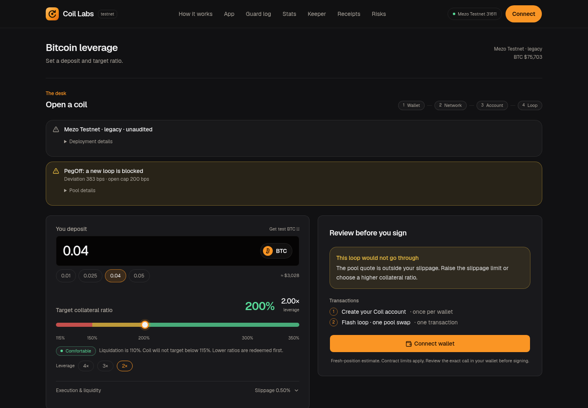
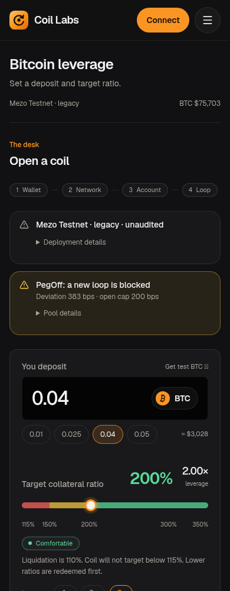

# Coil interface refinement: design QA

final result: passed

This is an adaptation of observed design principles to Coil's existing product, not a pixel-for-pixel clone of another application. No generated mockup is the implementation target.

## Inspected references

- [Designeer Finds: Unslopping a vibecoded dashboard](https://designeer.xyz/finds/heydamir-2115063463063998736): initial state and paused final frame at 8.7s of 9.8s inspected. Applied restrained sans typography, neutral surfaces, quieter grouping and useful density. No fictional card, revenue or chart data copied.
- [Designeer Inspiration: Mobbin](https://designeer.xyz/inspiration/mobbin): product-flow source opened and inspected.
- Current Coil home/form captured before the change; actual production export captured after it. Typography/layout comparison is against the existing Coil surface, not another product's viewport.

## Verified changes

| Criterion | Evidence |
| --- | --- |
| Restrain typography | Browser measured home heading86.4→24px, app heading48→20px and input36→32px at1440px. |
| Use one font family | Body and BTC input both resolve to Geist with system sans fallback. Serif and mono font downloads removed; tabular numeric behavior retained. |
| Surface the actual workflow | App section starts at y192 rather than y1556 at1440px. Education, historical receipts and risks remain below it and reachable by navigation. |
| Reduce visible secondary copy | Deployment and execution/liquidity details use native disclosures; disconnected pool explanation is expandable. Unaudited status, opening-block reason and deviation remain visible. Connected account cap controls retain their full explanation. |
| Preserve interaction | Amount presets/input, ratio presets/slider, slippage changes, disclosure keyboard operation and mobile menu/Escape/focus return passed. |
| Responsive layout |16 page/viewport checks at320/390/768/1440px; no horizontal overflow or observed page JavaScript errors. |
| Preserve financial meaning | All40 web tests pass; independent review found no blocking financial/control regressions. Quote/fee rows, owner/account handling and opening/Recovery Mode guards remain in their original owners. |

## Actual application captures

[Browser check results](docs/design/coil-refinement/browser-checks.json)

ESLint, TypeScript and production static build pass. The captured pool-bound/quote-block states are real read-only application states; these are not failed financial transactions, simulated positive quotes or funded acceptance proofs. Keeper data remains independently asynchronous/unconfigured where appropriate.

No claim of full accessibility certification, complete history indexing, new contract deployment, authenticated keeper health or mainnet readiness. Native Codex MCP attachment may require trusting/reloading the project; the saved launcher was exercised directly over MCP during research. No P0/P1/P2 visual or interaction findings remain in this scoped refinement.
