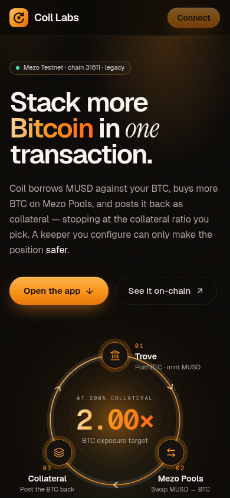
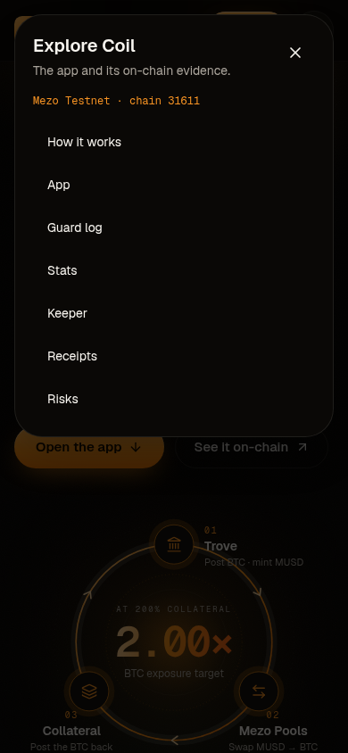
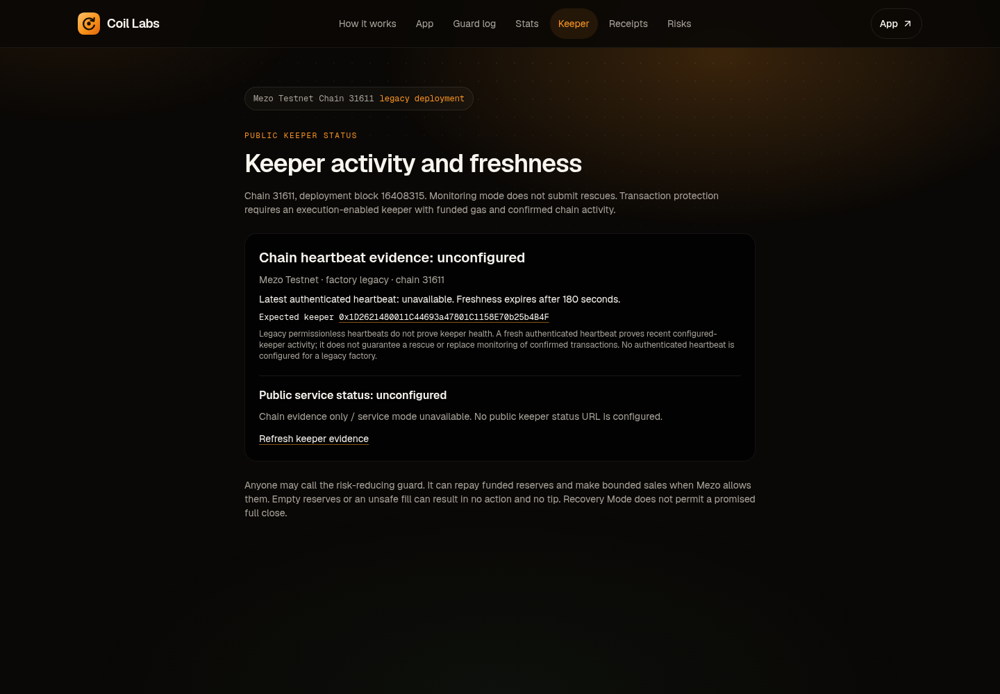

# Navigation enhancement: screenshot audit and verification

Captured 2026-11-07 (Asia/Kolkata). Before: current public Railway application. After: local static production export of this enhancement. Screenshots are browser captures, inspected before inclusion. These images establish presentation and navigation behavior, not new financial-release acceptance.

## Flow and findings

| Step | Surface | Finding and resulting health |
| --- | --- | --- |
| 1 | Mobile home | Primary navigation was hidden without a replacement. Added a seven-destination modal menu; verified usable at 320–1024px. |
| 2 | Open the app / desk | Menu App link closes the dialog and reveals the existing desk. Cross-page return from Keeper also reaches the desk. Navigation passes; market data may still be loading/unavailable independently. |
| 3 | Guard log | Plain text header replaced by the shared branded header, current-page indicator and app return. Navigation passes; event history remains asynchronous and scoped to loaded ranges. |
| 4 | Public Stats | Shared header and metadata wrapping remove split words on mobile. Navigation passes; base counts and history retain separate loading/incomplete states. |
| 5 | Keeper | Shared header identifies chain/deployment and active page. Navigation passes. Captured legacy keeper remains explicitly unconfigured; presentation changes do not make it healthy. |

### Before: mobile home

### After: all destinations available from mobile

### After: Keeper uses the shared header

## Verification

- Existing web suite: 40/40 passed; ESLint, TypeScript and production static build passed.
- Missing-menu check failed against the baseline, then passed against the new production export.
- [32 page/viewport checks](navigation-checks.json): four routes at 320, 390, 768, 1024, 1280, 1440, 1536 and 1920px; no horizontal overflow or page JavaScript errors observed. Dialog links and trigger are at least 44px. Checked modal focus containment, Escape dismissal, focus return, active-page links, same-page anchor and cross-page return.
- [Simulated connected wrong-network wallet](wallet-layout.json): no overflow at all eight widths. No wallet signing or transaction submission; narrow headers intentionally wrap.
- [Desktop label stress check](price-layout.json): synthetic $1,000,000 text at 1536/1920px; one header row, no overflow. The synthetic value is only a layout fixture, not market evidence.
- Independent static review: no substantive issues reported; additional desktop/anchor checks requested by the reviewer were completed.

## Limits

No claim of full accessibility compliance, screen-reader certification, authenticated keeper health, complete history indexing, funded public-chain action proofs, or mainnet readiness. Browser checks target navigation and responsive presentation. Legacy capability and partial-data disclosures, financial calculations, contract calls and release gates are retained.

The Product Design companion preflight/reference scripts and native browser execution tool were not exposed in this session; the existing product/code target and fresh standalone Chromium captures supplied the design grounding. No saved product preferences were written.
